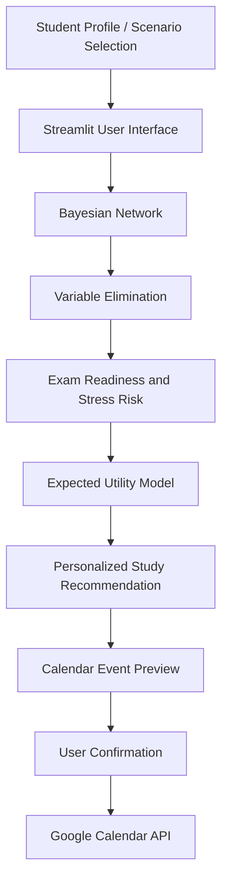
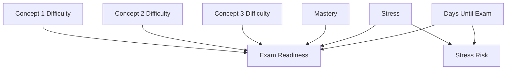
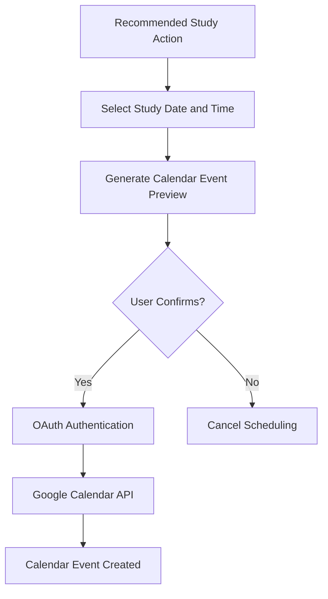

# 🧠 BayesStudy — Personalized Bayesian Study Planner


A personalized study planning and decision-support system that combines Bayesian inference, expected utility theory, and Google Calendar integration to help students make informed study decisions.

Developed as an individual project for **COSC 329 — Learning Analytics at the University of British Columbia Okanagan (UBCO).**

---

## 1. Project Overview

Students often face difficulties deciding how much time to spend studying, especially when dealing with challenging course material, limited preparation time, and academic stress.

BayesStudy addresses this problem by using a probabilistic model to estimate a student's exam readiness and stress risk. It then applies expected utility theory to compare alternative study actions and recommend the most suitable option under the model's assumptions.

The system provides an interactive Streamlit interface where students can enter their current academic situation, explore personalized recommendations, and schedule study sessions through Google Calendar.

### Project Objectives

- Model uncertainty in student learning and academic preparation.
- Apply Bayesian Networks to represent relationships between student characteristics and learning outcomes.
- Perform probabilistic inference using Variable Elimination.
- Apply expected utility theory to support personalized study decisions.
- Balance academic preparation, stress risk, and study time.
- Provide an interactive and accessible user interface.
- Integrate study recommendations with Google Calendar.
- Evaluate system behavior through automated testing and student scenario simulations.

---

## 2. Key Features

| Feature | Description |
|---|---|
| Bayesian Network | Represents relationships between concept difficulty, mastery, stress, exam proximity, and learning outcomes. |
| Bayesian Inference | Estimates exam readiness and stress risk using Variable Elimination. |
| Expected Utility | Evaluates alternative study actions based on projected benefits and costs. |
| Personalized Recommendations | Selects the study action with the highest expected utility. |
| Scenario Simulation | Provides three predefined student profiles for comparison and demonstration. |
| Interactive Web Application | Allows users to configure student profiles and visualize recommendations using Streamlit. |
| Google Calendar Integration | Creates study sessions through Google Calendar API and OAuth 2.0. |
| User Confirmation | Requires explicit confirmation before creating calendar events. |
| Automated Testing | Includes 33 passing tests covering the core model, inference, decision logic, calendar event generation, and scenarios. |

---

## 3. System Architecture

The system follows a modular architecture that separates probabilistic modeling, inference, decision-making, user interaction, and external service integration.



### Architecture Components

| Component | Responsibility |
|---|---|
| `cpt.py` | Defines prior probabilities and conditional probability tables. |
| `bayesian_model.py` | Constructs and validates the Bayesian Network. |
| `inference.py` | Performs probabilistic inference using Variable Elimination. |
| `decision.py` | Calculates expected utility and recommends study actions. |
| `calendar_integration.py` | Handles event generation, OAuth authentication, and Google Calendar API requests. |
| `scenarios.py` | Defines reusable student profiles for scenario simulation. |
| `app.py` | Provides the interactive Streamlit interface and integrates the system components. |

This separation improves maintainability, testability, and extensibility.

---

## 4. Bayesian Network

BayesStudy uses a discrete Bayesian Network implemented with the Python `pgmpy` library.

The network contains:

- 8 random variables
- 8 directed edges
- 8 conditional probability distributions
- 6 input variables
- 2 predicted outcome variables

### 4.1 Random Variables

| Variable | Possible States | Description |
|---|---|---|
| Concept1Difficulty | Easy, Hard | Difficulty of the first learning concept. |
| Concept2Difficulty | Easy, Hard | Difficulty of the second learning concept. |
| Concept3Difficulty | Easy, Hard | Difficulty of the third learning concept. |
| Mastery | Low, High | Student's current understanding of the learning material. |
| Stress | Low, High | Student's current perceived academic stress. |
| DaysUntilExam | Near, Far | Relative proximity of the upcoming examination. |
| ExamReadiness | Low, High | Estimated level of examination preparation. |
| StressRisk | Low, High | Estimated risk of elevated academic stress. |

### 4.2 Network Structure



Exam Readiness depends on all six input variables.

Stress Risk depends on the student's current stress level and exam proximity.

The network is validated using `model.check_model()` to ensure that the graph structure and probability distributions are consistent.

### 4.3 Prior Probability Distributions

The root variables use manually defined prior probabilities.

| Variable | State 1 | Probability | State 2 | Probability |
|---|---|---:|---|---:|
| Concept1Difficulty | Easy | 0.60 | Hard | 0.40 |
| Concept2Difficulty | Easy | 0.50 | Hard | 0.50 |
| Concept3Difficulty | Easy | 0.40 | Hard | 0.60 |
| Mastery | Low | 0.50 | High | 0.50 |
| Stress | Low | 0.60 | High | 0.40 |
| DaysUntilExam | Near | 0.40 | Far | 0.60 |

These probabilities represent prototype assumptions rather than estimates learned from an empirical student dataset.

### 4.4 Conditional Probability Tables

The conditional probability distributions represent the assumed relationships between student characteristics and predicted outcomes.

Exam Readiness is influenced by:

- The number of difficult learning concepts.
- The student's current mastery.
- The student's current stress level.
- The proximity of the examination.

The model assumes that higher mastery generally improves exam readiness, while difficult concepts, elevated stress, and approaching examinations can reduce readiness.

Stress Risk is modeled using the following conditional probabilities:

| Current Stress | Days Until Exam | P(StressRisk = Low) | P(StressRisk = High) |
|---|---|---:|---:|
| Low | Near | 0.65 | 0.35 |
| Low | Far | 0.90 | 0.10 |
| High | Near | 0.10 | 0.90 |
| High | Far | 0.45 | 0.55 |

All conditional probability distributions are validated to ensure that their probabilities sum to one.

---

## 5. Bayesian Inference

BayesStudy performs exact probabilistic inference using the Variable Elimination algorithm provided by `pgmpy`.

Given student evidence, the system estimates:

- P(ExamReadiness = High | Evidence)
- P(StressRisk = High | Evidence)

The inference module supports both complete and partial evidence.

### 5.1 Example Student Evidence

```python
student = {
    "Concept1Difficulty": "Hard",
    "Concept2Difficulty": "Easy",
    "Concept3Difficulty": "Hard",
    "Mastery": "Low",
    "Stress": "High",
    "DaysUntilExam": "Near",
}
```

### 5.2 Running Bayesian Inference

```bash
python -m src.inference
```

Example output:

```text
Student Prediction
------------------
Exam readiness (High): 15.00%
Stress risk (High): 90.00%
```

The results indicate that this student has a relatively low estimated level of exam readiness and a high estimated stress risk under the current model.

### 5.3 Partial Evidence

The inference module can also generate predictions when only some student characteristics are known.

```python
from src.inference import predict_student

result = predict_student({
    "Mastery": "High",
    "Stress": "Low",
})

print(result)
```

Unobserved variables are handled probabilistically through the Bayesian Network rather than requiring every input variable to be specified.

---

## 6. Expected Utility and Decision Making

BayesStudy extends probabilistic inference into a decision-support system using expected utility theory.

Instead of only predicting a student's academic condition, the system evaluates alternative study actions and selects the action with the highest estimated utility.

### 6.1 Available Study Actions

| Action | Duration | Description |
|---|---:|---|
| Intensive Study | 5 hours | Provides a larger estimated improvement in exam readiness at a higher time and stress cost. |
| Light Review | 1 hour | Provides a moderate estimated improvement with a lower time commitment. |
| Rest Day | 0 hours | Prioritizes recovery and reduced stress without additional study time. |

### 6.2 Action Effect Assumptions

The current prototype uses manually defined adjustments to estimate the potential effects of each action.

| Action | Readiness Adjustment | Stress Risk Adjustment | Study Hours |
|---|---:|---:|---:|
| Intensive Study | +0.25 | +0.15 | 5 |
| Light Review | +0.10 | +0.02 | 1 |
| Rest Day | 0.00 | -0.20 | 0 |

Adjusted probabilities are restricted to the interval [0, 1].

These adjustments are separate from the original Bayesian Network. They represent hypothetical action effects rather than empirically validated causal relationships.

### 6.3 Expected Utility Function

The decision model combines projected exam readiness, projected stress risk, and study duration.

```math
EU(a)=100P(R=\text{High}\mid e,a)-30P(S=\text{High}\mid e,a)-2h(a)
```

Where:

- `a` represents a possible study action.
- `e` represents the observed student evidence.
- `R` represents Exam Readiness.
- `S` represents Stress Risk.
- `h(a)` represents the study duration in hours.

The utility weights are defined as follows:

| Factor | Weight | Purpose |
|---|---:|---|
| Exam Readiness | +100 | Rewards improved academic preparation. |
| Stress Risk | -30 | Penalizes elevated stress risk. |
| Study Duration | -2 per hour | Represents the time and effort required by an action. |

The action with the highest expected utility is selected.

```math
a^*=\arg\max_a EU(a)
```

Expected utility values are relative decision scores, not probabilities. Therefore, negative utility values are valid.

### 6.4 Running the Decision Model

```bash
python -m src.decision
```

Example output:

```text
BayesStudy — Study Recommendation
--------------------------------
Intensive Study: EU = 0.00
Light Review: EU = -4.60
Rest Day: EU = -6.00

Recommended action: Intensive Study
```

In this example, Intensive Study produces the highest expected utility under the specified model assumptions.

---

## 7. Google Calendar Integration

BayesStudy integrates with Google Calendar to convert study recommendations into scheduled study sessions.

The integration uses:

- Google Calendar API v3
- OAuth 2.0 authentication
- Google API Python Client
- Google OAuth libraries

### 7.1 Calendar Scheduling Workflow



The system generates a preview before creating any calendar event.

Calendar event duration is determined by the recommended study action:

- Intensive Study: 5 hours.
- Light Review: 1 hour.
- Rest Day: No study event is created.

### 7.2 Google Cloud Configuration

To enable Google Calendar integration:

1. Open the [Google Cloud Console](https://console.cloud.google.com/).
2. Create a Google Cloud project.
3. Enable the Google Calendar API.
4. Configure the OAuth consent screen.
5. Add your Google account as a test user if the application is in testing mode.
6. Create an OAuth client with the application type set to Desktop app.
7. Download the OAuth credentials JSON file.
8. Rename the file to `credentials.json`.
9. Place the file in the project root directory.

### 7.3 Authentication and Security

The application uses OAuth 2.0 instead of directly collecting Google account passwords.

The requested permission scope is:

```text
https://www.googleapis.com/auth/calendar.events
```

This scope allows the application to manage calendar events.

The user must explicitly authorize access before the application can create an event.

The following files must remain private:

```text
credentials.json
token.json
client_secret*.json
```

These files are excluded from version control through `.gitignore`.

Never upload OAuth credentials or access tokens to a public repository.

### 7.4 Running Calendar Integration

```bash
python -m src.calendar_integration
```

The command-line demonstration generates an event preview using an example date and time. Update the example date and time in the module before running it if necessary.

Example output:

```text
BayesStudy - Google Calendar Integration
---------------------------------------
Calendar Event Preview
Title: BayesStudy - Light Review
Start: 2026-11-20T14:00:00-08:00
End: 2026-11-20T15:00:00-08:00

Add this event to Google Calendar? (yes/no):
```

If the user enters `no`, no calendar event is created.

If the user enters `yes`, the application authenticates with Google Calendar and attempts to create the event.

Successful API response:

```text
Google Calendar event created successfully!
Event link: https://www.google.com/calendar/event?...
```

The command-line OAuth authentication and calendar event creation workflow has been successfully tested using a real Google Calendar account.

---

## 8. Streamlit Web Application

BayesStudy provides an interactive web interface developed using Streamlit.

The interface integrates the Bayesian Network, inference engine, expected utility model, student scenarios, and Google Calendar scheduling into a single application.

### 8.1 Student Profile Configuration

Users can configure the following input variables:

- Concept 1 Difficulty
- Concept 2 Difficulty
- Concept 3 Difficulty
- Current Mastery
- Current Stress
- Days Until Exam

Users can either configure a custom student profile or select a predefined scenario.

### 8.2 Bayesian Prediction Dashboard

The dashboard displays:

- Probability of high exam readiness.
- Probability of high stress risk.
- Visual progress indicators for both predicted outcomes.

### 8.3 Expected Utility Visualization

The application provides:

- A bar chart comparing the expected utility of all available study actions.
- A table containing projected exam readiness.
- Projected stress risk.
- Study duration.
- Expected utility scores.

These visualizations allow users to understand why a particular study action is recommended.

### 8.4 Personalized Study Recommendation

The system displays:

- The recommended study action.
- Recommended study duration.
- Expected utility score.
- A short explanation of the recommendation.

### 8.5 Interactive Calendar Scheduling

Users can select a study date and start time directly within the application.

The application generates a calendar event preview based on the recommended study action.

The Google Calendar submission button requires explicit user confirmation.

The application also includes checks for past start times and repeated submission of the currently scheduled session within the active Streamlit session.

### 8.6 Model Transparency

An expandable information section explains:

- The Bayesian Network architecture.
- The expected utility function.
- The manually defined model assumptions.
- The limitations of the current prototype.

---

## 9. Student Scenario Simulation

BayesStudy includes three predefined student scenarios to demonstrate how different academic conditions affect predictions and study recommendations.

### Scenario 1 — Struggling Student

| Input | Value |
|---|---|
| Concept 1 Difficulty | Hard |
| Concept 2 Difficulty | Easy |
| Concept 3 Difficulty | Hard |
| Mastery | Low |
| Stress | High |
| Days Until Exam | Near |

Expected behavior:

- Relatively low exam readiness.
- High stress risk.
- Recommendation: Intensive Study.

### Scenario 2 — Average Student

| Input | Value |
|---|---|
| Concept 1 Difficulty | Easy |
| Concept 2 Difficulty | Hard |
| Concept 3 Difficulty | Easy |
| Mastery | Low |
| Stress | Low |
| Days Until Exam | Far |

Expected behavior:

- Moderate exam readiness.
- Relatively low stress risk.
- A recommendation based on the comparison of all three expected utility scores.

### Scenario 3 — Well-Prepared Student

| Input | Value |
|---|---|
| Concept 1 Difficulty | Easy |
| Concept 2 Difficulty | Easy |
| Concept 3 Difficulty | Easy |
| Mastery | High |
| Stress | Low |
| Days Until Exam | Far |

Expected behavior:

- High exam readiness.
- Relatively low stress risk.
- Recommendation: Light Review.

### Scenario Evaluation

The predefined scenarios demonstrate the system's ability to generate different predictions and recommendations based on student characteristics.

They also provide reproducible examples for automated testing, system evaluation, and project demonstrations.

These scenarios are synthetic examples and should not be interpreted as empirical evidence of real-world educational effectiveness.

---

## 10. Technology Stack

| Technology | Purpose |
|---|---|
| Python 3.12 | Core application development. |
| pgmpy | Bayesian Network construction and probabilistic inference. |
| NumPy | Numerical computation and probability manipulation. |
| pandas | Tabular data processing and visualization preparation. |
| Streamlit | Interactive web application development. |
| Google Calendar API | External calendar event scheduling. |
| OAuth 2.0 | Secure user authorization. |
| pytest | Automated testing. |
| Git and GitHub | Version control and project documentation. |

---

## 11. Project Structure

```text
bayesian-study-planner/
│
├── app.py
├── README.md
├── requirements.txt
├── .gitignore
│
├── src/
│   ├── cpt.py
│   ├── bayesian_model.py
│   ├── inference.py
│   ├── decision.py
│   ├── calendar_integration.py
│   └── scenarios.py
│
├── tests/
│   ├── test_bayesian_model.py
│   ├── test_inference.py
│   ├── test_decision.py
│   ├── test_calendar_integration.py
│   └── test_scenarios.py
│
└── docs/
    └── network_design.md
```

Local-only authentication files:

```text
credentials.json
token.json
```

These files are not included in the public repository.

---

## 12. Installation

### 12.1 Clone the Repository

```bash
git clone https://github.com/EsmeYang/bayesian-study-planner.git
cd bayesian-study-planner
```

### 12.2 Create a Virtual Environment

```bash
python3 -m venv .venv
```

Activate the virtual environment on macOS or Linux:

```bash
source .venv/bin/activate
```

For Windows PowerShell:

```powershell
.venv\Scripts\Activate.ps1
```

### 12.3 Install Dependencies

```bash
python -m pip install -r requirements.txt
```

### 12.4 Configure Google Calendar

Google Calendar integration requires a locally configured OAuth client.

Follow the Google Cloud configuration instructions in Section 7.

The Bayesian prediction, expected utility, and scenario simulation features can be used without authorizing Google Calendar access.

---

## 13. Running the Application

### Run the Bayesian Network

```bash
python -m src.bayesian_model
```

### Run Bayesian Inference

```bash
python -m src.inference
```

### Run Expected Utility Decision Making

```bash
python -m src.decision
```

### Run Google Calendar Integration

```bash
python -m src.calendar_integration
```

### Launch the Streamlit Web Application

```bash
python -m streamlit run app.py
```

Open the application in your browser:

[http://localhost:8501](http://localhost:8501)

### Application Usage

1. Select a predefined student scenario or configure a custom student profile.
2. Click **Generate Recommendation**.
3. Review the Bayesian prediction results.
4. Compare the expected utility of the available study actions.
5. Review the personalized study recommendation.
6. Select a study date and start time if scheduling is desired.
7. Review the generated calendar event preview.
8. Confirm and submit the event to Google Calendar.

To stop the local Streamlit server, press `Ctrl + C` in the terminal.

---

## 14. Automated Testing

The project uses `pytest` to validate the correctness of its core components.

### Run All Tests

```bash
python -m pytest -v
```

### Current Test Results

```text
33 passed
```

All 33 implemented automated tests passed during Week 12 development.

### Test Coverage by Component

| Component | Number of Tests | Status |
|---|---:|---|
| Bayesian Network | 7 | Passed |
| Bayesian Inference | 5 | Passed |
| Expected Utility and Decision Making | 7 | Passed |
| Calendar Event Generation | 6 | Passed |
| Student Scenario Simulation | 8 | Passed |
| **Total** | **33** | **Passed** |

### 14.1 Bayesian Network Testing

Tests verify:

- Bayesian Network validity.
- Correct number of random variables.
- Correct number of directed edges.
- Correct number of conditional probability distributions.
- Probability normalization.
- Parent relationships for Exam Readiness.
- Parent relationships for Stress Risk.

### 14.2 Bayesian Inference Testing

Tests verify:

- Predicted probabilities remain within valid bounds.
- Higher stress increases predicted stress risk.
- Higher mastery improves predicted exam readiness.
- Correct predictions for a fully observed student profile.
- Support for partial evidence.

### 14.3 Expected Utility Testing

Tests verify:

- Availability of all three study actions.
- Correct study durations.
- Expected utility calculation.
- Valid adjusted probabilities.
- Handling of invalid study actions.
- Selection of the highest-utility recommendation.
- Return of all available action evaluations.

### 14.4 Calendar Integration Testing

Tests verify:

- Correct Intensive Study event duration.
- Correct Light Review event duration.
- No study event generation for Rest Day.
- Required calendar event fields.
- Handling of invalid actions.
- Timezone validation.

These automated tests validate event generation without making live Google Calendar API requests.

OAuth authentication and actual calendar event creation are evaluated separately through manual integration testing.

### 14.5 Scenario Simulation Testing

Tests verify:

- Availability of all three predefined scenarios.
- Correct number of student input variables.
- Handling of invalid scenario names.
- Protection of original scenario data through copying.
- Expected recommendation for the Struggling Student scenario.
- Expected recommendation for the Well-Prepared Student scenario.
- Higher readiness for the Well-Prepared Student compared with the Struggling Student.
- Successful recommendation generation for all predefined scenarios.

The passing test count demonstrates that the implemented test cases succeeded. It does not represent measured code coverage or guarantee the absence of all defects.

---

## 15. Learning Analytics and Educational Applications

BayesStudy demonstrates how Learning Analytics techniques can support personalized academic decision-making.

The project combines three major concepts.

### Probabilistic Modeling

Bayesian Networks represent uncertainty and dependencies between student characteristics and learning outcomes.

### Decision Support

Expected utility theory provides a structured approach to comparing alternative study actions under uncertainty.

### Personalized Learning

Different student profiles can generate different predictions and recommendations, allowing the system to adapt its output to individual academic situations.

Potential educational applications include:

- Personalized study planning.
- Examination preparation support.
- Student self-regulated learning.
- Academic workload management.
- Exploration of relationships between mastery, difficulty, and stress.
- Educational decision-support system prototypes.

BayesStudy is intended as a learning analytics prototype rather than a validated academic or mental health assessment tool.

---

## 16. Model Assumptions and Limitations

The current implementation has several limitations.

### Manually Defined Probabilities

The Bayesian Network uses handcrafted prior and conditional probability distributions rather than probabilities estimated from real student data.

### Simplified Student Representation

The model represents mastery, stress, concept difficulty, and exam proximity using binary states.

Real student characteristics are more complex and may require additional variables or continuous measurements.

### Hypothetical Action Effects

The effects of Intensive Study, Light Review, and Rest Day are represented through manually defined probability adjustments.

These effects have not been established through controlled educational experiments.

### Fixed Utility Weights

The utility function uses fixed weights for readiness, stress risk, and study duration.

Different students may have different preferences and priorities.

### Limited Personalization

Personalization is currently based on user-provided student characteristics rather than historical learning behavior or continuously updated student records.

### Calendar Scheduling Limitations

The application does not automatically detect scheduling conflicts or optimize study sessions across multiple days.

Calendar submission requires user authorization and an available Google Calendar connection.

Duplicate-event protection is limited to the current application session and is not a persistent scheduling guarantee.

### Evaluation Limitations

The system has been evaluated through automated tests, synthetic student scenarios, and manual integration testing.

Further evaluation using real student data would be required to assess predictive accuracy and educational effectiveness.

---

## 17. Development Roadmap

| Week | Milestone | Status |
|---|---|---|
| Week 8 | Python environment setup and Bayesian Network construction | Completed |
| Week 9 | Variable Elimination and probabilistic inference | Completed |
| Week 10 | Expected utility and personalized study recommendations | Completed |
| Week 11 | Google Calendar API and OAuth integration | Completed |
| Week 12 | Streamlit interface and student scenario simulation | Implemented — Automated tests passed |
| Week 13 | System evaluation, sensitivity analysis, and final presentation preparation | Planned |
| Week 14 | Final documentation, project refinement, and submission | Planned |

### Current Development Status

The core Bayesian inference, decision-making, scenario simulation, calendar integration, and interactive web application have been implemented.

All 33 automated tests currently pass.

The next development stage focuses on completing end-to-end verification, evaluating system behavior, analyzing model sensitivity, and preparing the final project presentation and documentation.

---

## 18. Future Improvements

Potential future extensions include:

- Learning Bayesian Network parameters from real educational datasets.
- Introducing more detailed mastery and stress levels.
- Allowing students to customize utility weights.
- Performing sensitivity analysis on probability distributions and decision parameters.
- Incorporating historical learning behavior.
- Supporting multiple courses and examinations.
- Automatically detecting calendar scheduling conflicts.
- Generating multi-day personalized study schedules.
- Improving persistent duplicate-event prevention.
- Expanding automated testing to cover the Streamlit interface and mocked Google Calendar API interactions.
- Evaluating recommendation quality through user studies.

---

## 19. References and Resources

- [pgmpy Documentation](https://pgmpy.org/)
- [Streamlit Documentation](https://docs.streamlit.io/)
- [Google Calendar API Documentation](https://developers.google.com/workspace/calendar/api)
- [Google Calendar API Python Quickstart](https://developers.google.com/workspace/calendar/api/quickstart/python)
- [Google OAuth 2.0 Documentation](https://developers.google.com/identity/protocols/oauth2)
- [pytest Documentation](https://docs.pytest.org/)
- [Python Documentation](https://docs.python.org/3/)

The project also applies concepts introduced in COSC 329, including Bayesian Networks, probabilistic inference, uncertainty modeling, and expected utility theory.

---

## 20. AI Assistance

Generative AI assistance was used during development to support:

- Implementation planning.
- Python code development.
- Debugging and troubleshooting.
- Automated test design.
- Streamlit interface development.
- Google Calendar integration guidance.
- Technical documentation.

The implementation was developed and tested locally, with automated tests and manual execution used to verify system behavior.

---

## 21. Author

**Esme Yang**

Computer Science — Bachelor of Science

University of British Columbia Okanagan

COSC 329 — Learning Analytics

GitHub: [EsmeYang](https://github.com/EsmeYang)

---

**BayesStudy — Turning uncertainty into personalized study decisions.**